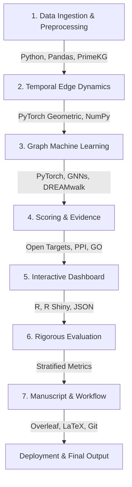
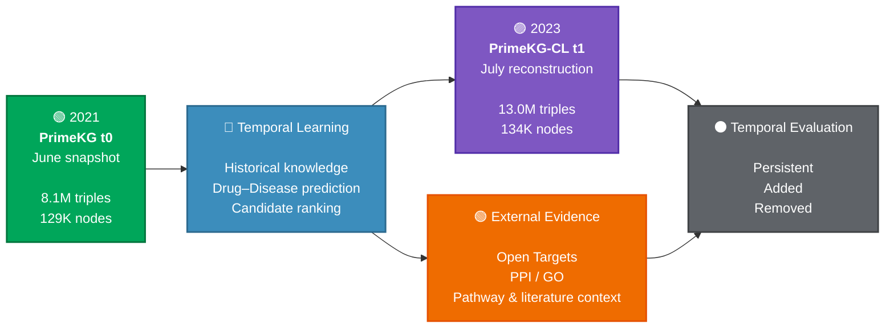

# PharmaGraph — Continual Graph Learning for Drug Repurposing on Evolving Biomedical Knowledge Graphs

  

**Status:** 🟢 Completed · 🔵 In Progress · ⚫ Planned
## 1. Introduction

Drug repurposing — finding new therapeutic uses for existing drugs — depends
heavily on biomedical knowledge graphs (KGs) that link drugs, targets,
diseases, and phenotypes. Most graph-learning benchmarks treat these KGs as
static snapshots, but real curated databases are never static: associations
get added as new evidence arrives, and previously accepted links get
retracted as ontologies are corrected. A model trained once on a fixed graph
silently drifts out of date, and standard continual-learning (CL) benchmarks
don't capture this — they simulate "new tasks" by artificially splitting a
single static graph, not by tracking how a real graph actually changed over
time.

**PharmaGraph** addresses this gap directly. It is built on **PrimeKG-CL**, a
benchmark constructed from two genuine temporal snapshots of PrimeKG — June
2021 and July 2023 — with a real, measured diff between them (what was
added, what was removed, what persisted), rather than a synthetic split.

The goal of this project is to build and evaluate a drug-disease link
prediction system that:
- generalizes correctly across **genuine** graph evolution (not just an
  arbitrary train/test split),
- produces predictions that are **evidence-grounded and explainable**
  rather than an opaque score, so results are usable for translational
  research triage, not just leaderboard ranking.

Full dataset documentation (schema, provenance, task splits, feature
coverage) lives in [`data/benchmark/README.md`](data/benchmark/README.md); this file focuses on
*what we are doing with it and why*.

## 2. Data (summary)

PharmaGraph uses the **PrimeKG-CL Benchmark v1.0**, providing a genuinely temporal evaluation framework rather than a synthetic split:

| Snapshot / Layer | Role & Description | Triples | Nodes | Relations |
| :--- | :--- | :---: | :---: | :---: |
| **$t_0$ — June 2021** | Historical training and candidate generation baseline. | 8,100,498 | 129,375 | 30 |
| **$t_1$ — July 2023** | Temporal evaluation target held out exclusively for testing. | 13,001,666 | 134,211 | 25 |
| **External Evidence** | Complementary evidence layer (Open Targets, PPI, GO), separate from PrimeKG-CL. | — | — | — |

**Temporal Evolution & Diff Breakdown:**
Between $t_0$ and $t_1$, **7,208,624** triples persisted unchanged, **5,760,234** were added (including GO annotations, disease-phenotype refinement, and drug-target updates), and **888,848** were removed (due to retracted associations and ontology corrections). This structural evolution forms the exact foundation for the stratified evaluation (persistent / added / removed edges) used in Step 9.

### **Core Data Pipeline Flow**

See `data/benchmark/README.md` for the full breakdown: task definitions, multimodal
feature coverage, and citation information.

## 3. Methodology

The pipeline below reflects our current working plan. Status markers show
where we actually are, not where the plan assumes we'll end up — this will
be updated as steps complete.

[ 🟢 Data Ingestion & Prep ] ──> [ 🔵 Heterogeneous GNN ] ──> [ ⏳ Evidence Scoring ] ──> [ ⏳ GraphRAG Explanation ] ──> [ ⏳ Temporal Evaluation ]

| Step | Description | Status |
|---|---|---|
| 1. Foundation | Load PrimeKG-CL t0 (Jun 2021) — 8.1M triples, 10 node types, 30 relations. t1 (Jul 2023) is held out entirely for temporal testing. | ✅ Done |
| 2. Preprocessing | Clean (dedupe, verify no missing values / self-loops), build node index, encode edges, construct the full graph as a PyTorch Geometric `HeteroData` object (10 node types, 53 relation-direction pairs). | ✅ Done |
| 3. Task definition | Drug–disease link prediction. Positive labels: `indication` (and possibly `off-label use`) edges. `contraindication` edges are reserved as hard negatives, not just noise. | ✅ Done |
| 4. Baseline model | 2-layer heterogeneous GraphSAGE, chosen over R-GCN for compute efficiency (R-GCN needs a separate weight matrix per relation type; we have 53). Node features: molecular/protein embeddings . | 🔄 In progress |
| 5. Loss & negative sampling | Margin-based ranking loss, mixing random negatives with hard negatives drawn from `contraindication` edges. | ✅ Done |
| 6. Evidence scoring | scoring	Two evidence sources beyond the model: Open Targets target-disease association scores (fetch_open_targets.py, bridged from gene-level to drug-level via each drug's known targets), and PPI/GO-similarity features computed directly from the graph (ppi_go_features.py — PPI shortest-path/common-neighbors, GO term Jaccard overlap across biological_process / molecular_function / cellular_component). Code complete; not yet executed end-to-end against the real Open Targets bulk data. | ✅ Done |
| 7. Evidence-aware ranking | Final score = model prediction + evidence features + calibration status.
combine_evidence.py scores every candidate pair with the trained model (no retraining), merges in Open Targets + PPI/GO evidence, and compares two fusion strategies: a grid-searched weighted formula, and a logistic-regression re-ranker trained on the train split. Reports AUROC/AUPRC for model-alone vs. each fusion option. Code complete, pending Step 6's data. | 🔄 In progress |
| 8. Path explanation | Extract multi-hop biological paths (Drug → Target → Pathway → Disease) for top candidates; generate GraphRAG-style explanations. | ⏳ Planned |
| 9. Evaluation | Test exclusively on the t1 (Jul 2023) snapshot, stratified by persistent / added / removed edges. Metrics: Hits@K, MRR, AUPRC, Precision@K, evidence support rate. | ⏳ Planned |

**Current status:** Steps 1–5 complete with real trained checkpoints. Steps 6–7 have working code awaiting a full run. Steps 8–9 not yet started — Step 9 in particular is a known gap, not an oversight: every metric reported so far is t0-internal, not the genuine temporal generalization test this benchmark is built around.
 
## 4. Results
 
Three GraphSAGE variants were trained and compared on the internal t0 train/val/test split (see the caveat in Step 9 above — these are not yet temporal-generalization numbers):
 
| Version | Test AUROC | Test AUPRC |
|---|---|---|
| v1: placeholder node features | 0.7918 | 0.5542 |
| v2: real molecular features, no regularization | 0.7288 | 0.4857 |
| v3: real molecular features + dropout/weight decay | **0.9137** | **0.8687** |
 
v3 is the best-performing configuration and is the one carried forward into the evidence-scoring stage.
 
**Sanity check — is v3's 0.91 AUROC genuine, or is the model just recognizing chemically similar drugs?**
Since 83.4% of test-set drugs have a near-identical molecular "twin" already in the training set, we stratified test performance by twin presence:
 
| Test subset | Share of test pairs | AUROC |
|---|---|---|
| Has a chemical twin in train | 83.4% | 0.9188 |
| No twin (genuinely novel drug) | 16.6% | 0.8214 |
 
The gap (+0.097 AUROC) shows the model performs meaningfully worse on drugs it can't chemically "look up" — a real effect, though not catastrophic (0.82 AUROC on truly novel drugs is still a substantive result, far above chance). This is a more honest framing than claiming the twin effect is negligible: it isn't, but it also doesn't explain away the model's performance entirely.

### Evidence fusion (Step 6–7)
 
> **TODO before treating this as final:** confirm which checkpoint (`v2` vs `v3`) `score_with_model.py` actually loaded for this run — the baseline AUROC below (0.7458) matches v2, not v3's 0.9137. If it was v2, re-run against the v3 checkpoint before reporting these numbers anywhere final.
 
`combine_evidence.py` scores every candidate pair with the trained model, then compares two ways of folding in Open Targets + PPI/GO evidence on top of it:
 
| | Test AUROC | Test AUPRC |
|---|---|---|
| Baseline (model alone) | 0.7458 | 0.4973 |
| Option A: weighted formula (grid-searched on val) | 0.7581 | 0.5455 |
| Option B: logistic regression re-ranker | **0.7673** | **0.5730** |
 
Evidence fusion improves both metrics over the model alone, with the learned re-ranker (Option B) outperforming the hand-weighted formula.
 
**Two caveats before over-interpreting this:**
- Open Targets received ~0 weight in Option A and a small negative coefficient in Option B — likely a coverage issue (few candidate pairs had a real Open Targets score after bridging gene-level scores to drug-level) rather than evidence that OT associations are actively unhelpful. Needs the actual coverage percentage confirmed before drawing a conclusion either way.
- The two GO-similarity features (`go_jaccard_bp`, `go_jaccard_mf`) show opposite-signed coefficients in Option B despite both representing "more similarity" — a likely sign of multicollinearity between correlated GO categories rather than a genuine biological finding that molecular-function similarity predicts *against* efficacy.
 
4. Interactive Dashboard

Alongside the modeling pipeline, PharmaGraph includes an R Shiny dashboard for exploring the benchmark itself: how the graph changed between snapshots, which drug–disease edges were added/removed/persisted, and a network view around any selected disease.

Overview — headline stats and an added/removed/persistent triple breakdown between t0 and t1.
Temporal Evolution — the same breakdown, per relation type.
Drug–Disease — per-disease view of every relevant edge, tagged by which snapshot(s) it appears in.
Network Analysis — a 1-hop interactive graph around a selected disease (t1 snapshot).
Benchmarking — reserved for model results (Hits@K, MRR, AUPRC, Precision@K) once evaluation (Step 9 above) is complete; currently a placeholder.

The app reads small precomputed summaries (statistics.json, diffs/diff_t0_t1.json) directly, and queries the raw 8.1M/13M-row snapshots through a cached Python layer (src/dashboard_data.py) exposed to R via reticulate 

full architecture, data dependencies, and run instructions are documented in [dashboard/README.md](dashboard/README.md).
## 4. Repository layout

See the top-level directory listing for the full structure (`data/`,
`src/`, `dashboard/`, `notebooks/`, `output/`, etc.). The dataset itself and
its full schema/metadata are documented separately in `data/README.md` to
keep this file focused on project narrative rather than data mechanics.